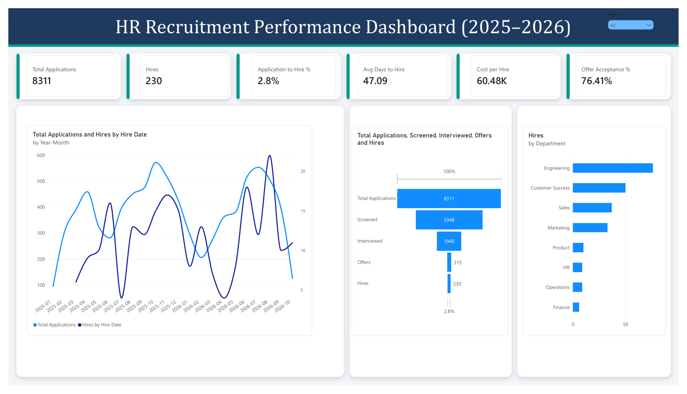
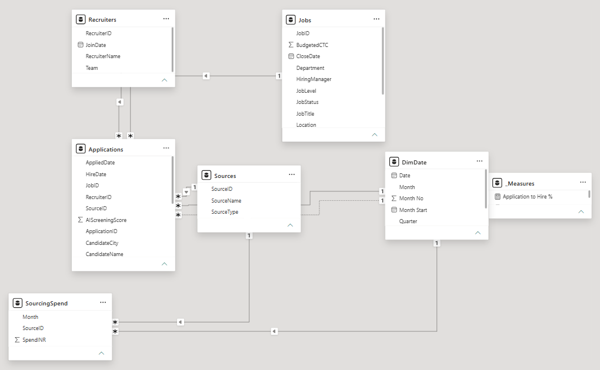
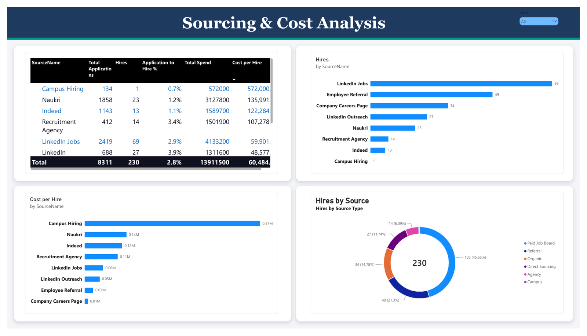
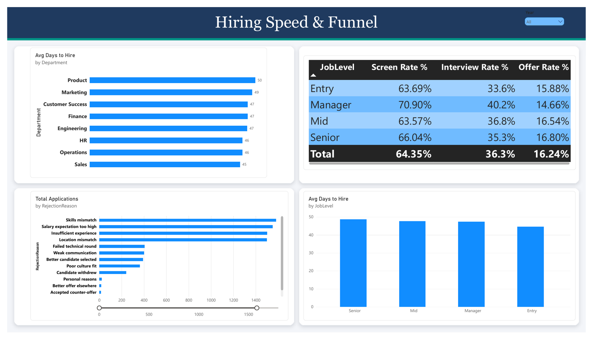
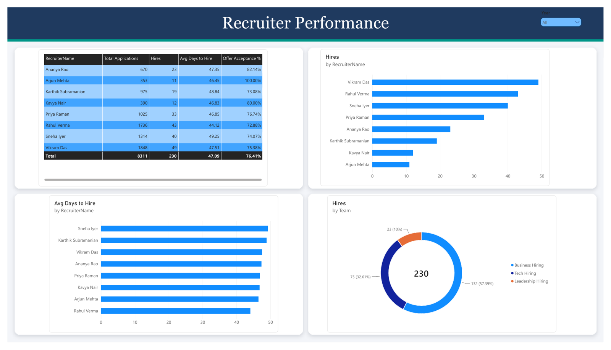

# HR Recruitment Performance Dashboard (2025–2026)

A 4-page Power BI dashboard that analyses a company's hiring process: where candidates come from, how fast they are hired, what each hire costs, and how recruiters perform.

> **Note:** The dataset is synthetic (made-up sample data) created for learning and portfolio purposes.



## Business questions answered

1. How many people applied, and how many were hired?
2. Where do candidates drop out of the hiring funnel?
3. Which sourcing channels give the most hires for the least money?
4. How long does it take to hire, and which departments are slowest?
5. Which recruiters perform best?

## Dataset

8,311 applications for 140 jobs, Jan 2025 – Oct 2026 (costs in INR).

| Table | Type | Rows | Description |
|---|---|---|---|
| Applications | Fact | 8,311 | One row per candidate application, with stage dates |
| SourcingSpend | Fact | 176 | Monthly spend per sourcing channel |
| Jobs | Dimension | 140 | Job requisitions (department, level, location) |
| Recruiters | Dimension | 8 | Recruiters and their teams |
| Sources | Dimension | 8 | Sourcing channels (LinkedIn, Naukri, Referral, etc.) |
| DimDate | Dimension | — | DAX-generated date table |

## Data model

Star schema with one-to-many relationships from dimensions to facts. `Applications[HireDate] → DimDate[Date]` is an **inactive** relationship, activated with `USERELATIONSHIP` for hire-date measures.



## Key DAX measures

```DAX
Total Applications = COUNTROWS ( Applications )
Hires = COUNT ( Applications[HireDate] )
Application to Hire % = DIVIDE ( [Hires], [Total Applications] )
Offer Acceptance % = DIVIDE ( [Hires], [Hires] + [Offers Declined] )
Hires by Hire Date = CALCULATE ( [Hires], USERELATIONSHIP ( Applications[HireDate], DimDate[Date] ) )
Avg Days to Hire = AVERAGEX ( FILTER ( Applications, NOT ISBLANK ( Applications[HireDate] ) ),
                   DATEDIFF ( Applications[AppliedDate], Applications[HireDate], DAY ) )
Cost per Hire = DIVIDE ( [Total Spend], [Hires by Hire Date] )
```

17 measures in total, stored in a dedicated `_Measures` table.

## Report pages

| Page | What it shows |
|---|---|
| **Overview** | 6 KPI cards, monthly applications vs hires, hiring funnel, hires by department |
| **Sourcing & Cost** | Source scorecard table, hires by source, cost per hire by source, hires by source type |
| **Hiring Speed** | Days to hire by department and job level, conversion rates by level, rejection reasons |
| **Recruiters** | Recruiter scorecard, hires and speed by recruiter, hires by team |

A **Year** slicer is synced across all pages.





## Key insights

- **8,311 applications → 230 hires** (2.8% application-to-hire rate), average **47 days** to hire, **₹60,485** cost per hire.
- **Employee referrals** convert at **7.3%** — about 2.6x the average — at **₹27,245** per hire, less than half the average cost.
- **Naukri and Indeed** bring 36% of applications but only 16% of hires, at more than 2x the average cost per hire.
- The biggest funnel drop is **Screened → Interview** (only 36% move on).
- **1 in 4 offers is declined** (76.4% acceptance).
- **Product** is the slowest department to hire for (~50 days); **Sales** is the fastest (~45 days).
- **Campus Hiring** cost ₹5.7 lakh for a single hire — the weakest channel.

## Tools and skills

Power BI Desktop · Power Query · Data modelling (star schema) · DAX · Time intelligence · Synced slicers · Report design

## Files

| File | Description |
|---|---|
| `HR Recruitment Performance Dashboard.pbix` | Power BI report |
| `HR Recruitment Performance Dashboard.pdf` | PDF export of all 4 pages |
| `Recruitment_Analytics_Data.xlsx` | Source dataset |
| `screenshots/` | Page screenshots |

## Author

Dinesh B
